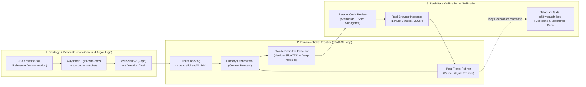

# Ellie's Book — Master Architecture & Multi-Agent Development Roadmap

> **Strategist & Lead Architect**: Gemini 4 Argon (High)
> **Definitive Task Executor**: Claude (via `CLAUDE.md` + `.agent/skills/implement` & `tdd`)
> **Parallel Specialists**: Gemini Pro / Flash Subagents (`code-review`, `inspect.mjs`, `reverse-engineer-anything`)
> **Owner**: **SHUAI** (`Chen Shuaizhou`)

---

## 1. Executive Synthesis: Current Baseline vs. Target Product (`[Fact]` + `[Inference]`)

### 1.1 Verified Baseline Inherited from `Business Function Budget Tracker` (`[Fact]`)
- **Domain Engine (`app/budget-domain.mjs` & `app/page.tsx`)**:
  - Proven three-perspective financial model (**Operational**, **Managerial**, **Accounting**) over one shared client-side dataset (`StudioData`, schema v2).
  - Project-led workflow with `General` + custom `WorkPackage`s, `PurchaseItem`s, multi-vendor/warehouse/country `SourcingAllocation`s (with zero parent double-counting), and `Quotation -> PO -> Invoice` commitment conversion logic.
  - Controlled metadata (`TagFamily`, `TagValue`), replaceable metadata-coded project IDs (`GUC-MU+FRAG-0001`) backed by immutable internal `recordId`s, curation inbox for `Project-only` vs. `Reusable` definitions, and 20-table normalized exports (`Markdown`, `TSV`, `CSV`) with formula-injection protection and leading-zero GL code preservation (`"001230"`).
- **Approved Graph V1 Specification (`docs/foundation/GRAPH-PURCHASE-LIST-CONTRACT.md`)**:
  - Defines the canonical **Graph-to-Table Equivalence Rule**: collapsed node = summary roll-up; expanded node = 1 relational row; node type = 1 table; typed edge = relational foreign key (`ContainmentEdge`, `PurchaseLink`, `LifecycleTransition`).
- **Identified Technical Debt & Gaps (`[Fact]`)**:
  1. **Monolithic UI file**: `app/page.tsx` is 245 KB (single-file state + UI) containing ~150 lines of dead `*Legacy` components.
  2. **Missing Graph & Obsidian Layer**: The interactive node canvas and Obsidian `[[wikilink]]` knowledge graph specified in the vision and `GRAPH-PURCHASE-LIST-CONTRACT.md` have 0 lines of UI code implemented yet.
  3. **Local-Only Persistence**: `db/schema.ts` (Drizzle/SQLite/D1) is empty (`export {};`); state lives only in browser `localStorage`, preventing phone-to-desktop synchronization.
  4. **Single-Bar Charting**: Only a single horizontal `FinancialBar` exists; time-series expenditure curves, burn-rate charts, and multi-sheet `.xlsx` workbooks are not yet built.

---

## 2. Three Differentiating Product Pillars of Ellie's Book

| Pillar | Target User Value | Architectural Mechanism |
| :--- | :--- | :--- |
| **Pillar 1: Visual Canvas Map (Fundamental Hero Interface)** *(ADR 0002)* | The visual graph is the core selling point. Non-finance operators grasp project structure, deliverables, and spending intuitively as an interactive network instead of battling spreadsheets. | **Dual-Layer Graph Canvas + Desktop Inspector Drawer**: • **Structured Flow Nodes**: `Project -> WorkPackage -> PurchaseItem -> SourcingAllocation -> Quotation/PO/Invoice`. • **Obsidian Knowledge Overlay**: Markdown notes with `[[wikilinks]]` attached to any node. • **Desktop Inspector Drawer ($\ge 960\text{px}$)**: Slide-over drawer displaying Operational, Managerial, and Accounting perspectives while keeping the map active in the background. |
| **Pillar 2: Auditable Modular Tables & Clear Charts (Zero Black Box)** | Every node and link is formally extractable as relational tables, audit trails, and clear financial/timeline charts. | **Bi-Directional Projection Engine**: • Every graph mutation writes to normalized relational tables (`Projects`, `BudgetVersions`, `PurchaseItems`, `SourcingAllocations`, `LifecycleRecords`, `LifecycleLines`, `PurchaseLinks`, `LifecycleTransitions`, `AuditEvents`). • Real-time table grid view, time-series burn/phasing charts (`Q1`–`Q4` + monthly actuals vs. commitments vs. approved baseline), and multi-sheet `.xlsx` / CSV / Markdown vault export. |
| **Pillar 3: Adaptive Mobile Operations (Capture, Insights, Approvals)** *(ADR 0002)* | Manage team, project deliverables, approvals, and on-the-fly expense capture from a phone without complex touch-dragging. | **Mobile-First Action Hub ($390\text{px}$–$680\text{px}$)**: • **No Canvas Dragging**: Touch manipulation of node geometry is disabled on phones to avoid touch fatigue. • **Quick Capture Bottom Sheet**: 1-tap logging of quotes, invoices, and field notes. • **Instant Pulse**: 3-second budget health check (`Left to Spend`, `Paid & Ordered`). • **1-Tap Approvals**: Swift controller sign-off queue for proposed budget revisions. • **Storage**: Drizzle SQLite / Cloudflare D1 + local IndexedDB/Vault sync. |

---

## 3. Multi-Agent Execution Architecture (Matt Pocock + PentAGI + Taste-Skill + REA)

---

## 4. Phased Tracer-Bullet Vertical Slices (`to-tickets` Backlog)

Each wave consists of self-contained vertical slices designed for **Claude** to execute deterministically under **Gemini 4 Argon (High)** supervision, with mandatory checkpoints between slices.

### Wave 1: Deep Module Decomposition & Canonical Relational Core
- **Ticket `W1-T1` — Extract Deep Domain & State Engine Modules (`codebase-design` + `tdd`)**
  - **Objective**: Decompose the 245 KB `app/page.tsx` monolith into deep, pure TypeScript modules under `src/domain/` (`types.ts`, `calculations.ts`, `identifiers.ts`, `exports.ts`, `migrations.ts`, `sample-posm.ts`) and remove ~150 lines of dead `*Legacy` components while keeping 100% of existing tests green.
  - **Seam Test**: `tests/budget-domain.test.mjs` + full equivalence snapshot on the POSM USD 11,600 scenario.
- **Ticket `W1-T2` — Implement Graph V1 Relational Entities & Immutable `BudgetVersion` (`tdd`)**
  - **Objective**: Add `BudgetVersion` (immutable `Original`/`Adjustment` with `Proposed`/`Approved`), `PurchaseLink`, `LifecycleTransition`, `AuditEvent`, and `KnowledgeNote` (`[[wikilink]]` parser + backlink index) to the domain and Drizzle schema (`db/schema.ts`), plus blocking validation for over-allocation.
  - **Seam Test**: Deterministic unit tests verifying version immutability, commitment conversion without double-counting, over-allocation rejection, and bidirectional `[[wikilink]]` resolution.

### Wave 2: Node-Based Workflow Canvas & Obsidian Knowledge Graph (Pillar 1)
- **Ticket `W2-T1` — Reference Deconstruction & Art Direction Deal (`reverse-engineer-anything` + `taste-skill --app`)**
  - **Objective**: Run `taste-skill` (`--app` mode) to establish the design system tokens (typography, surface hierarchy, node/edge color semantics: containment vs. document lineage vs. knowledge backlink) and verify zero AI-slop patterns.
- **Ticket `W2-T2` — Synchronized Node Canvas & Inspector Surface (`implement` + `tdd`)**
  - **Objective**: Build the interactive Node Graph view where `Project`, `WorkPackage`, `PurchaseItem`, `SourcingAllocation`, `LifecycleRecord`, and `KnowledgeNote` render as collapsible/expandable nodes with typed edges, inspector drawer, and node-action creation (`+ Item`, `+ Allocation`, `+ PO/Invoice Link`, `+ [[Note]]`).
  - **Invariant Check**: Dragging nodes mutates only view coordinates; all node edits immediately reflect in the relational table state.

### Wave 3: Auditable Modular Tables, Clear Charts & Workbook Engine (Pillar 2)
- **Ticket `W3-T1` — Modular Relational Table Grid & Audit Trail Explorer**
  - **Objective**: Build the formal tabular workbench allowing instant switching between any canonical table (`Projects`, `Purchase_Items`, `Sourcing_Allocations`, `Budget_Versions`, `Lifecycle_Records`, `Lifecycle_Lines`, `Purchase_Links`, `Lifecycle_Transitions`, `Audit_Events`) with inline filtering, lineage trace-back to source documents, and multi-sheet `.xlsx` / CSV / Obsidian Markdown folder export.
- **Ticket `W3-T2` — Plan-vs-Reality Visual Analytics & Time-Series Charts**
  - **Objective**: Implement clear, non-slop financial and operational charts (`assets/charts.js` / SVG):
    1. Quarter & Monthly Spend Trajectory (`Approved Baseline` vs. `Cumulative Actuals + Open Commitments` vs. `Forecast`).
    2. Work-Package & Function Headroom Waterfall.
    3. Deliverable & Outcome Evidence Progress Matrix.

### Wave 4: Mobile-First On-the-Fly Operations & Cloud/Local Persistence (Pillar 3)
- **Ticket `W4-T1` — Mobile On-the-Fly Command Surface (`390px` Viewport Optimization)**
  - **Objective**: Build a dedicated mobile navigation bar, Touch Outline/Card mode for the node graph, Quick Expense / Quotation Capture sheet, and 1-Tap Controller Approval / Exception Review queue verified at `390px` width with zero horizontal overflow.
- **Ticket `W4-T2` — Hybrid Persistence Layer (Local-First Vault + Drizzle D1 / SQLite Sync)**
  - **Objective**: Wire `db/schema.ts` and API routes so Ellie's Book runs seamlessly as either a local desktop/vault application or a cloud-hosted SaaS with workspace authentication.

---

## 5. Decision Gates Requiring SHUAI's Input (Telegram + Chat)

Before launching **Wave 1 (`W1-T1` & `W1-T2`)** and **Wave 2**, only three high-leverage architectural decisions require SHUAI's confirmation:
1. **Primary Persistence Mode for V1 Commercial Target**:
   - *Option A (Recommended)*: **Hybrid Local-First + Cloud D1/SQLite** (instant offline/local IndexedDB + Obsidian Markdown export/import on device, backed by Drizzle SQLite/Cloudflare D1 for cross-device phone/desktop sync).
   - *Option B*: **Cloud-Only SaaS Database** (requires login for all usage).
   - *Option C*: **Local Markdown/SQLite Desktop-First** (Electron/Tauri or local server synced via Git/Obsidian Vault).
2. **Graph Canvas Interaction Style**:
   - *Option A (Recommended)*: **Dual-Mode Graph** — Structured Auto-Layout Tree/DAG for financial lineage (`Project -> WorkPackage -> Item -> Allocation -> PO/Invoice`) + Toggleable Force/Freeform Knowledge Overlay for Obsidian `[[wikilinks]]` and notes.
   - *Option B*: **Pure Freeform Infinite Canvas** (like Obsidian Canvas / Miro where users manually place every card).
3. **Claude Execution Integration on This Machine**:
   - Currently `claude` CLI is not installed in `PATH` on this Windows machine (`[Fact]`). We can either:
     - *Option A*: Install Claude Code CLI (`npm install -g @anthropic-ai/claude-code`) / configure your Claude subscription or API key so Antigravity can dispatch definitive coding tickets directly to Claude CLI in isolated git worktrees; OR
     - *Option B*: Maintain `.scratch/tickets/` and `CLAUDE.md` in `woussc/Ellies-Book` so you can run Claude on the repo alongside Antigravity subagents.
